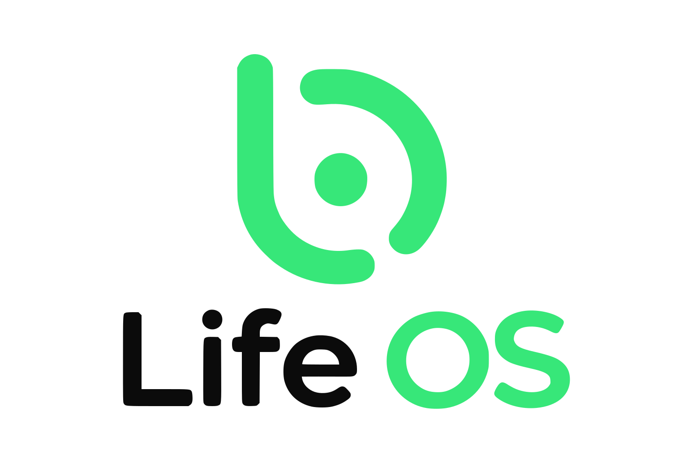
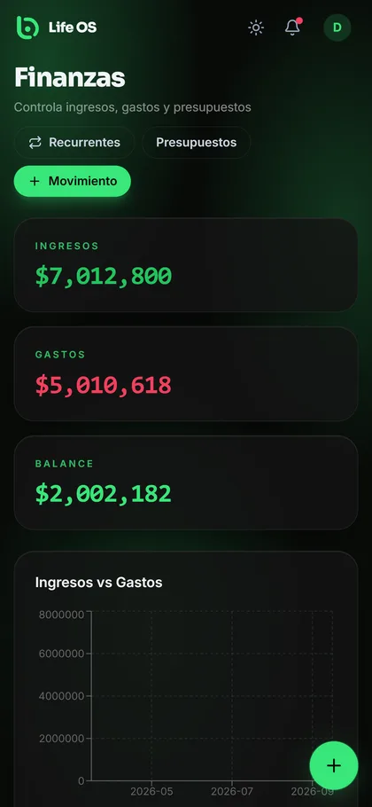
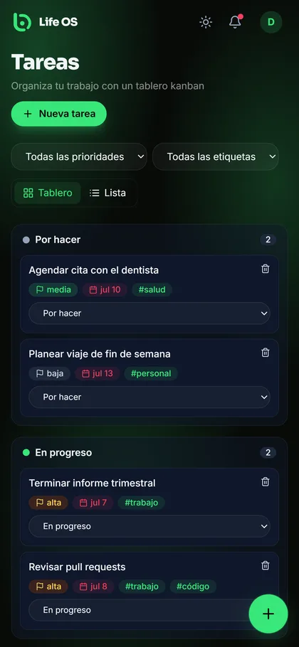
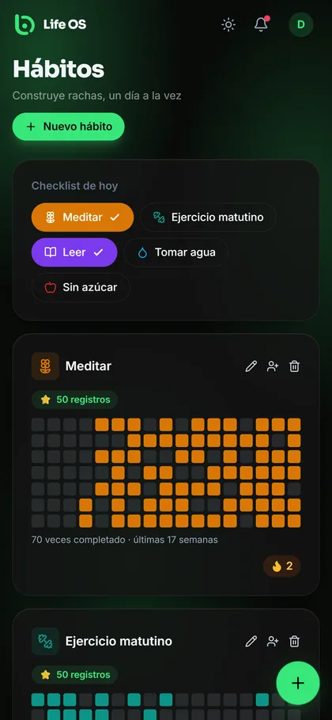
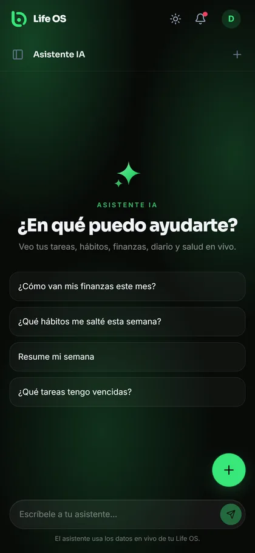

<p align="center">
  <picture>
    <source media="(prefers-color-scheme: dark)" srcset="client/public/brand/logo-lockup-white-text.svg">
    <source media="(prefers-color-scheme: light)" srcset="client/public/brand/logo-lockup-dark-text.svg">
    
  </picture>
</p>

<p align="center">
  <b>Tu vida, organizada en un solo lugar.</b><br>
  Finanzas, tareas, hábitos, calendario, diario y notas — con un asistente de IA
  que conoce tus propios datos. Comparte hábitos y tareas con tus amigos.
</p>

<p align="center">
  <a href="https://github.com/brandonxf/LifeOS-2.0/releases/latest">
    
  </a>
  <a href="https://lifeos-landing-liart.vercel.app">
    
  </a>
</p>

<p align="center">
  
  
  
</p>

---

## 📱 Capturas

<p align="center">
  
  
  
  
</p>

## 💡 ¿Qué puedes hacer con Life OS?

- 💰 **Finanzas** — registra tus ingresos y gastos, ponte presupuestos y mira en una
  gráfica a dónde se va tu plata cada mes.
- ✅ **Tareas** — un tablero donde arrastras y sueltas tus pendientes entre
  "por hacer", "en progreso" y "listo".
- 🔥 **Hábitos y metas** — marca con un toque los hábitos del día, mira tu racha y
  tu progreso hacia cada meta con una cuenta regresiva.
- 📅 **Calendario** — todos tus eventos del mes o de la semana, de un vistazo.
- 📓 **Diario** — escribe cómo te sientes cada día, anota tu ánimo y, si quieres,
  protégelo con un PIN para que solo tú lo leas.
- 🗒️ **Notas** — guarda ideas y búscalas luego, incluso si no recuerdas la palabra
  exacta que usaste.
- 👥 **Amigos** — agrega amigos con un código de invitación, comparte hábitos y
  asígnense tareas en equipo.
- 🤖 **Asistente de IA** — pregúntale lo que sea sobre tu propia información: te
  responde ya conociendo tus finanzas, tareas, hábitos y más.

Además: modo oscuro, funciona sin conexión como app instalable, y todo se actualiza
casi al instante cuando tú o tus amigos hacen cambios.

---

## 📲 ¿Cómo la instalo?

Life OS para Android se instala directo, sin pasar por ninguna tienda de apps.

1. Abre el botón **"Descargar APK"** de arriba desde tu celular (o entra a la
   [página de releases](https://github.com/brandonxf/LifeOS-2.0/releases/latest)).
2. Al abrir el archivo descargado, Android puede preguntarte si confías en
   "instalar apps desconocidas" para tu navegador — es normal al instalar fuera
   de Play Store, acepta y continúa.
3. Abre la app, **crea tu cuenta** (o entra con la cuenta de prueba
   `demo@lifeos.app` / `demo1234` para ver cómo funciona) y listo.

> 🔔 La app te avisa sola, dentro de la propia app, cuando sale una versión nueva.

¿Prefieres verla desde el navegador? Entra a la [página web](https://lifeos-landing-liart.vercel.app).

---

<details>
<summary><b>🛠️ Información técnica (para desarrolladores)</b></summary>

### Stack

     

- **Frontend:** React 18, Vite, TailwindCSS, React Router v6, TanStack Query, Zustand, Recharts, TipTap, @hello-pangea/dnd, React Hook Form + Zod — compilado también a APK con Capacitor
- **Backend:** Node.js + Express (API REST, streaming SSE)
- **Base de datos:** [Neon](https://neon.tech) Postgres serverless + Drizzle ORM + Drizzle Kit, con **pgvector** para búsqueda semántica de notas
- **Caché/Sesiones:** Redis ([Upstash](https://upstash.com) recomendado) — con respaldo automático en memoria para desarrollo local
- **IA:** [Groq](https://console.groq.com) (compatible con OpenAI, inferencia muy rápida) por defecto, con respaldo en Anthropic Claude si solo esa clave está configurada
- **Auth:** Tokens de acceso JWT + bcrypt + refresh tokens rotativos

### Estructura

```
life-os/
├─ api/                    # Entrada de la Serverless Function de Vercel
├─ client/                 # Frontend React + Vite (y proyecto Android de Capacitor en client/android)
├─ server/                 # Backend Express
├─ vercel.json             # Un solo despliegue: cliente estático + función serverless /api/*
└─ .env.example
```

### Puesta en marcha

```bash
git clone https://github.com/brandonxf/LifeOS-2.0.git life-os
cd life-os
npm install                     # instala client + server (workspaces)

cp .env.example server/.env
cp .env.example client/.env     # el cliente solo necesita VITE_API_URL
```

Edita `server/.env` y define al menos `DATABASE_URL`, `JWT_SECRET`,
`JWT_REFRESH_SECRET` (y `GROQ_API_KEY` o `ANTHROPIC_API_KEY` para IA real en vez
del modo demo). Genera secretos fuertes con `openssl rand -base64 48`.

```bash
cd server
npx tsx src/db/migrate.ts       # habilita pgvector en Neon
npm run db:push                 # sube el esquema (pide confirmación por terminal
                                 # si detecta algo potencialmente destructivo)
npm run db:seed                 # usuario demo + datos realistas

cd ..
npm run dev                     # server (:4000) + client (:5173)
```

| Variable | Dónde | Descripción |
|-----|-------|-------------|
| `DATABASE_URL` | server | Connection string agrupado de Postgres en Neon |
| `REDIS_URL` | server | URL de Upstash Redis (opcional — cae a memoria) |
| `JWT_SECRET` / `JWT_REFRESH_SECRET` | server | Secretos para firmar tokens de acceso/refresh |
| `GROQ_API_KEY` / `ANTHROPIC_API_KEY` | server | Proveedor de IA (Groq primero, Claude de respaldo) |
| `CLIENT_URL` | server | Lista blanca de CORS (defensa en profundidad) |
| `VITE_API_URL` | client | Solo para el build de Android (`client/.env.android`) — el build web usa `/api` relativo |

### Compilar el APK

```bash
cd client
npm run build:android           # build web en modo "android" (URL absoluta de API)
npx cap sync android
cd android && ./gradlew assembleDebug
```

El APK sale en `client/android/app/build/outputs/apk/debug/app-debug.apk`.

### Publicar una actualización

1. Sube el `versionCode`/`versionName` en `client/android/app/build.gradle`.
2. Compila el APK (pasos de arriba).
3. Crea un release en GitHub con el APK como asset (`gh release create vX.Y.Z ruta/al.apk`).
4. Listo — la [página web](https://lifeos-landing-liart.vercel.app) y el aviso dentro
   de la app leen el último release automáticamente, no hay que tocar nada más.

### Despliegue (Vercel)

Un solo proyecto de Vercel sirve cliente + API (mismo dominio, sin CORS):

1. **New Project** → importa el repo con el **Root Directory en la raíz** (no en `client/`).
2. Agrega las variables de entorno del servidor como **Environment Variables**. **No**
   definas `VITE_API_URL` en Vercel — dejarla sin definir es lo que hace que el cliente
   llame a `/api` en el mismo origen.
3. Despliega. Después, actualiza `client/.env.android` con ese dominio antes de volver
   a compilar el APK (la app nativa sí necesita una URL absoluta).

**Alternativa (Docker, solo si alojas la API fuera de Vercel):**
```bash
cd server
docker build -t life-os-server .
docker run -p 4000:4000 --env-file .env life-os-server
```

### Cómo funciona el contexto de la IA

En cada `POST /api/ai/chat` el servidor arma una foto en vivo de tus datos (últimas
tareas, hábitos de hoy, resumen financiero, ánimos recientes) y la manda como
contexto antes de transmitir la respuesta por Server-Sent Events. La interfaz muestra
una insignia con exactamente qué se envió. La búsqueda semántica de notas usa un
embedding local de 1536 dimensiones guardado en pgvector (HNSW/coseno) —
`server/src/services/embedding.service.ts` si quieres cambiarlo por una API externa.

### Amigos y actividad en tiempo real

Los amigos se agregan por código de invitación (`friend_code`), nunca por un directorio
público. Agregar amigo, unirse a un hábito o que te asignen una tarea siempre es
solicitud → aceptar/rechazar. Como la API vive en una función serverless sin conexiones
persistentes, las pantallas de Amigos/Hábitos/Tareas hacen **polling** (5-10s) en vez de
WebSockets (`client/src/lib/live.ts`).

### Scripts

| Comando | Ubicación | Qué hace |
|---------|----------|------|
| `npm run dev` | raíz | Corre cliente + servidor juntos |
| `npm run db:push` | server | Sube el esquema a Neon |
| `npm run db:seed` | server | Siembra datos de demo |
| `npm run build` | raíz | Compila ambas apps |

</details>

---

<p align="center">Hecho con 💜 — tu vida, organizada.</p>
